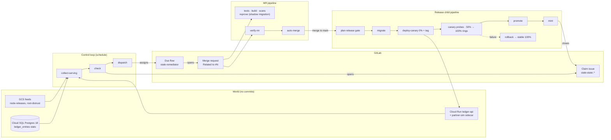

# Stale

> Public GitHub mirror (snapshot). The pipelines, issues, Duo flow runs and full history live in the GitLab project: https://gitlab.com/gitlab-ai-hackathon/transcend-october-2026/43668335/showcase. Live service: https://ledger-api-ihjeuvjbka-uc.a.run.app/status

**Stale treats every "safe to ship" verdict as a cached value with evidence behind it, and re-verifies it when the outside world changes, with no human in the loop.**

Built for the GitLab Transcend "Life After Code" hackathon · Path A (Start Fresh) · Hands-off autonomy.

**Live:** [status page on Cloud Run](https://ledger-api-ihjeuvjbka-uc.a.run.app/status) · **Evidence:** [every run, with links](docs/demo-evidence.md) · **Pipelines:** [history](https://gitlab.com/gitlab-ai-hackathon/transcend-october-2026/43668335/showcase/-/pipelines) · **Verification log:** [what was tested and what deviated from the spec](docs/verification-log.md)

### Results at a glance

| Run | What happened, with no human in the loop |
|---|---|
| Scenario A | Node security release + root distrust (feeds only) → issue → GitLab Duo MR → scans, re-proof, auto-merge → canary (distrusted partner now rejected) → 50% → 100% → issue closed by `mint`. 26 minutes. |
| Scenario A + B | Two claims stale at once → two issues, two Duo MRs → first release **defers** → second release ships both, including the agent's `CREATE INDEX CONCURRENTLY` rewrite → both issues closed. |
| Forced failure | Canary fails at 50% → traffic back to the stable revision at 100% → the next scheduled control loop re-releases → success. |
| Policy | A hand-made "remediation" MR that edits `.stale/` → rejected by `verify-mr`, claim quarantined, nothing merged. |

## Why

Each of these incidents was a safety verdict that was true when it was made, and that nobody re-checked when the world moved under it.

| Incident | The verdict that went stale | What changed, with no commit | Source |
|---|---|---|---|
| CrowdStrike Channel File 291 (2024-07-19) | "This content update is compatible with the deployed sensor" | A new template type defined 21 input fields; the sensor supplied 20 | [CrowdStrike RCA](https://www.crowdstrike.com/en-us/blog/channel-file-291-rca-available/) |
| Railway API outage (2025-10-28) | "This migration is safe" (approved when the table was small) | The table grew to ~1 billion rows; the index build without `CONCURRENTLY` locked it for ~30 min | [Railway incident report](https://blog.railway.com/p/incident-report-oct-28th-2025) |
| axios on npm (2026-03-30/31) | "Our pinned dependencies are trustworthy" | A maintainer account was taken over and `1.14.1` / `0.30.4` shipped a malicious install-time dependency | [Microsoft](https://www.microsoft.com/en-us/security/blog/2026/04/01/mitigating-the-axios-npm-supply-chain-compromise/), [StepSecurity](https://www.stepsecurity.io/blog/axios-compromised-on-npm-malicious-versions-drop-remote-access-trojan) |
| eMudhra distrust + Node.js 24.22.1 (2026-10-17 → 21) | "Every root our service trusts is trustworthy, and our Node is patched" | Weak eMudhra CA keys were found; Mozilla removed *emSign ECC Root CA - G3* (NSS 3.131.1); Node shipped security release v24.22.1 | [Help Net Security](https://www.helpnetsecurity.com/2026/10/21/emudhra-certificates-private-keys-compromised/), [Node.js v24.22.1](https://nodejs.org/en/blog/release/v24.22.1) |

## The idea

A **claim** (`.stale/claims/*.yaml`) is a versioned safety assertion with evidence collectors, deterministic rules, a remediation playbook, and re-proofs. The loop:

1. **The world changes, with no commit.** A root program distrusts a CA, Node ships a security release, a table grows. In the demo, `demo/world_shift.py` writes only to a public GCS feed bucket and to Cloud SQL.
2. **Deterministic code notices.** The scheduled control loop collects evidence from the *serving* revision and live database statistics, evaluates the claim's rules, and opens an issue with a byte-exact machine block of facts.
3. **A GitLab Duo custom flow writes the fix.** The `stale-remediator` flow is assigned to the issue and opens one merge request, editing only the claim's `allowPaths`.
4. **CI proves the fix.** Security scans, the claim's rules re-run inside the built image, a shadow migration under write load, then a Cloud Run canary with probes against the canary's tag URL and SLO rings.
5. **The release promotes, re-mints the claim, and closes the issue.** Only `stale mint` closes it, after 100% promotion.

**Rule of the system:** only deterministic code decides whether a claim is stale, whether an MR may merge, whether a canary passed, and how many retries remain. The LLM decides only *how* to fix, inside `allowPaths`; `verify-mr` rejects and quarantines anything else.

## Architecture



Google Cloud access from CI uses GitLab `id_tokens` and Workload Identity Federation only. No service-account key exists.

## Claims in this repo

| Claim | Evidence | Rules | Fix the flow may write | Re-proofs |
|---|---|---|---|---|
| `anchor-trusted` | `/internal/runtime` of the serving revision (or the report printed inside the candidate image), Node release feed, root-distrust feed | **R0** trust store unobservable · **R1** Node below the line's security floor · **R2** Node line past EOL · **R3** distrusted anchor in the effective CA set · **R4** weak anchor key (EC `k·G`, k < 2^16; RSA < 2048) | `app/ledger-api/Dockerfile` (`ARG NODE_IMAGE`), `deploy/trust/excluded-spki.txt` | rules on the candidate image; canary: trusted partner 200, distrusted partner rejected, runtime report matches |
| `migration-safe` | pending SQL migrations parsed with `pglast`, live `pg_class` statistics | **M1** blocking `CREATE INDEX` on a large table · **M3** blocking lock without `lock_timeout` ≤ 2 s · **M4** `CONCURRENTLY` inside a transaction · **M5** concurrent build not retry-safe | `app/ledger-api/db/migrations/**` | shadow migration at 1.2× the threshold with a writer and a `pg_locks` timeline; canary: schema applied, no invalid index |

The trust fix never uses `--use-system-ca` (it *adds* roots). `src/trust-policy.cjs` filters `tls.getCACertificates('default')` by SPKI hash and calls `tls.setDefaultCACertificates()` at startup.

## Claim lifecycle

Live state is derived from issue labels plus a fresh rule evaluation; the lockfile stores only minted proofs.

| From → To | Done by |
|---|---|
| VALID → STALE | `check` opens the issue (`stale-claim::<id>`, `stale-state::stale`) |
| STALE → REMEDIATING | `dispatch` assigns the remediator flow, `stale-attempt::1` |
| REMEDIATING → REPROVING | `mark-reproving` when the remediation MR gets its pipeline |
| REPROVING → VALID | `mint` after 100% promotion: lockfile commit, summary note, issue closed |
| REPROVING → REMEDIATING | `rollback` + `rollback-transition`: `retry-pending`, next attempt. On the next control loop (after an analyst note or 10 min), `dispatch` re-releases if the fix is already merged, otherwise re-assigns the remediator |
| REMEDIATING (session failed) | `dispatch` re-assigns the remediator when its Duo session failed before opening an MR; after 3 failed sessions the claim is quarantined |
| any → QUARANTINED | `verify-mr` policy violation, or attempts exhausted; a human is assigned |

## The hands-off trigger chain

`schedule` → `collect-serving` → `check` opens issue → `dispatch` assigns the Duo service account → **Assign trigger** starts `stale-remediator` → flow opens MR → MR pipeline (`verify-mr` enables auto-merge; tests, scans, `reprove`) → merge to `main` → `plan-release` (gate: pass / defer / block) → release child → `mint` closes the issue.

Duo flows act with a composite identity: GitLab shows the MR author as the user who triggered the flow, while every commit is authored by the flow's service account. `verify-mr` therefore checks provenance (all commits by a service account, plus a note by the remediator account on the claim issue linking this MR) as well as paths, labels and wording. MR decision jobs (`verify-mr`, `mark-reproving`, `reprove`) load `engine/` and `.stale/` from the target branch, so an MR cannot weaken the policy that judges it.

When two claims go stale together, the first merge's gate returns **defer** (the other claim's fix is still in flight); the second merge ships both.

## DevSecOps stages covered

| Stage | Jobs that run in this project |
|---|---|
| Plan | `validate`, `collect-serving`, `check` (opens the issue) |
| Create | `dispatch` → Duo `stale-remediator` writes the MR; `mark-reproving` |
| Verify | `engine-tests` (pytest + Postgres 18), `app-tests` (node:test with real TLS handshakes) |
| Package | `build-candidate` (Kaniko → GitLab registry), `inspect-candidate` (runs inside the image), `publish-ar` (→ Artifact Registry) |
| Secure | `semgrep-sast`, `secret_detection`, `container_scanning`, `security-gate`, `reprove` (rules on the candidate, shadow migration) |
| Configure | `record-stable`, WIF credential exchange, Cloud Run traffic tags |
| Release | `plan-release`, `release` (child trigger), `migrate`, `deploy-canary` |
| Monitor | `canary-reprove`, `canary-ring` (k6 + per-revision 5xx from Cloud Monitoring), `rollback` |
| Govern | `verify-mr` + auto-merge, `promote`, `mint`, `report`, quarantine |

In the release child, `promote` runs in `govern` because it must follow the `monitor` ring checks; `rollback` runs in `.post` with `when: on_failure`.

## Real vs simulated

| Element | In the demo | In production |
|---|---|---|
| Distrusted root | *Demo Root G3* (demo PKI), listed in a GCS-hosted distrust feed we update | Collector reads a feed derived from root-program actions |
| Node security release | Mirror of the real `nodejs.org/dist/index.json`; the baseline omits v24.22.1 | `nodejs.org/dist/index.json` directly |
| Table growth | Real rows inserted into Cloud SQL, then `ANALYZE` | Organic growth |
| Cloud Run, Cloud SQL, scans, canary, Duo flows, issues, MRs | Real | Real |

No real compromised keys, no exploit code, and no third-party systems are touched. Demo certificates and keys in `app/partner-sim/certs/` are demo-only.

## Setup

Prerequisites: a GCP project with billing, `gcloud`, `glab` (logged in), Python 3.12, Docker.

```bash
# 1. Google Cloud: APIs, Artifact Registry, Cloud SQL, feeds bucket, service accounts, WIF.
GITLAB_PROJECT_PATH=<group>/<project> GITLAB_PROJECT_ID=<id> infra/setup.sh
# 2. Labels.
infra/gitlab-labels.sh <project id>
# 3. CI image (or run a pipeline with STALE_PIPELINE=ci-image).
docker build -f ci/images/stale-ci/Dockerfile -t $CI_REGISTRY_IMAGE/stale-ci:latest . && docker push ...
```

Then, in GitLab:

- Add `STALE_BOT_TOKEN` (Maintainer token, scopes `api`, `write_repository`) as a masked, protected CI/CD variable.
- Protect `stale/*` (push: Developers + Maintainers). Turn on "Pipelines must succeed".
- Register `duo/flows/stale-remediator.yaml` (Automate → Flows → New flow), enable the **Assign** trigger, and set `STALE_REMEDIATOR_USER_ID` / `STALE_REMEDIATOR_USERNAME`.
- Create pipeline schedules on `main`, named exactly: `control-loop` (`*/15 * * * *`, active), and `release`, `smoke`, `ci-image` (inactive; use **Play** to run them). The lane is chosen from the schedule's description, so no pipeline variables are needed. Where pipeline variables are allowed, `STALE_PIPELINE=<lane>` on a manual run works too.

All variables are listed in `engine/stale_engine/config.py` (SRS §4).

## Run the demo

```bash
python demo/world_shift.py reset        # baseline feeds; 2 demo users + 100k rows; index migration pending
# Play the `release` schedule            → baseline ships; /status shows all claims VALID
python demo/world_shift.py scenario-a   # Node v24.22.1 security release + Demo Root G3 distrusted
python demo/world_shift.py scenario-b   # ledger_entries grows past the 500k-row threshold
# Play the `control-loop` schedule (or wait for its */15 run)
```

Watch: two issues open, two Duo sessions run, two MRs open and auto-merge, the first release defers, the second ships both fixes, both issues close. `/status` on the Cloud Run URL shows the new revision, Node v24.22.1, Demo Root G3 removed, and the merchant index valid.

Forced failure path: set the CI variable `STALE_DEMO_BREAK_CANARY=1` before a release. The ring fails at 50%, traffic returns to the stable revision at 100%, `rollback-reason.json` is written, and the claim goes to `retry-pending`.

Local stack (no cloud): `docker compose up -d --build` and `demo/local/acceptance.sh`.

## Limitations

- Cloud Run has no shared cache in this path, so the session-isolation ring check guards the app's cache contract (`private, no-store`), not a CDN.
- R4 (weak keys) is implemented and tested with a k=4 key, but the demo's *Demo Root G3* has a normal key: a scalar-4 root in the baseline would make the claim stale before any world change (see `docs/verification-log.md`).
- A failed canary does not roll back a migration; the migration rules guarantee expand-only, non-blocking, retry-safe DDL, which is why that is safe.
- Cloud Monitoring ingests request metrics with a 1–3 minute delay; when there is no data yet, the per-revision 5xx check says so and the k6 thresholds gate the ring.
- Hackathon role limits: the provisioned "Developer + AI" role cannot create project access tokens, protect `stale/*` branches, enable "Pipelines must succeed", or allow pipeline variables. So the bot token is a team member's personal access token (bot actions show as that user), `STALE_BOT_TOKEN` and `DB_PASSWORD` are masked but not protected so remediation-branch pipelines can read them, auto-merge (which waits for a green pipeline) is the merge gate, and manual lanes run from schedules.
- The remediation itself is written by an LLM. `verify-mr`, the scans, the re-proofs, and the canary are what make it safe to merge without a human.

## What's next

- `dependency-trusted` (the axios class): provenance disappearing, a new publisher, new install scripts, a too-young version (rules D1–D4 are specified).
- `contract-compatible` (the CrowdStrike class): a config field unsupported by the oldest live `contract_version`.
- The `stale-canary-analyst` flow (diagnosis notes on failed releases), a scheduled release-train lane, Terraform for `infra/`, and SCI accounting for skipped re-proofs.
- A production root-feed adapter built from Mozilla OneCRL and root-store removals.

## License

MIT — see [LICENSE](LICENSE).
